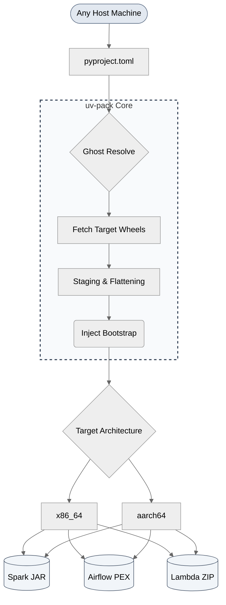

# uv-pack 📦

**The Universal Cross-Platform Packager for Python.**

`uv-pack` is a specialized build-orchestration tool designed to produce platform-agnostic, deployment-ready Python artifacts (JAR, PEX, ZIP) from any host OS. It leverages `uv` for high-speed, cross-platform dependency resolution and provides a "Standardized Build" contract for Data Engineering pipelines.

## Workflow: From Local Dev to Cloud Prod



## 🚀 The Problem: "The Platform Tax"

Enterprise data environments (Spark, Flink, AWS Lambda) often run on different architectures than developer laptops.

*   **Infrastructure Friction:** Organizations maintain expensive Linux "Build Runners" just to package artifacts for Linux.
*   **Architecture Lock-in:** Switching to cost-efficient hardware like **AWS Graviton (ARM)** is difficult because build pipelines are hard-coded to Intel/AMD chipsets.
*   **Fragile Deployments:** Native extensions (NumPy, Pandas) often crash due to OS mismatches when bundled using simple ZIP hacks.

## ✨ Key Features

*   **Zero-Docker Cross-Packaging:** Build for `linux-x86_64` or `linux-aarch64` directly from your MacBook using "Ghost Resolution".
*   **Powered by `uv`:** Leverages the world's fastest resolver and downloader for near-instant builds.
*   **Dual-Identity Artifacts:** Produces JARs that are fully compatible with the JVM (Spark/Flink) while remaining native to Python.
*   **Architecture Aware:** Automatically identifies and fetches the correct "Manylinux" wheels for your target destination.
*   **Standardized Build Contract:** Define build targets in `pyproject.toml` for consistent pipeline execution.

---

## 🛠 Configuration

`uv-pack` uses a hierarchical configuration in `pyproject.toml`. Global settings provide fallbacks, while target-specific settings allow for platform overrides.

```toml
[tool.uv-pack]
# --- Global Defaults ---
project_name = "analytics-engine"
default_target = "spark-prod"
output_base = "./dist"

[tool.uv-pack.targets.spark-prod]
# --- Core Settings ---
format = "jar"                  # Options: "jar", "pex", "zip"
entry_point = "app.main:run"    # Callable string: module.submodule:function

# --- Resolution Settings (Cross-Platform) ---
platform = "linux"              # Options: "linux", "macos", "windows"
arch = "x86_64"                 # Options: "x86_64", "aarch64" (ARM)
python_version = "3.10"         # Specific Python version for the target
manylinux = "2014"              # glibc version (Options: "2010", "2014", "31")

# --- Packaging Strategy ---
bundle = "fat"                  # "fat" (deps included), "slim" (source only)
include_binaries = true         # Whether to include compiled .so files
compression = "deflated"        # Options: "stored", "deflated"

# --- Advanced Options ---
exclude = ["tests/*", "**/__pycache__", "*.pyc", ".git*"]
extra_files = { "config/prod.yaml" = "resources/config.yaml" }
```

---

## 🛠 Installation (Dev)

```bash
# Clone the repository
git clone https://github.com/amarlearning/uv-pack.git
cd uv-pack

# Install uv (https://docs.astral.sh/uv/)
brew install uv  # macOS (or see docs for other OS)

# Sync (creates .venv and installs deps from pyproject + dev extras)
UV_PROJECT_ENVIRONMENT=.venv uv sync --all-extras

# Run quality checks
uv run ruff check .
uv run black --check .
uv run mypy src
uv run pytest -q
```

> Note: Requires `uv` on PATH. Prefer `uv run ...` for all dev commands.

---

## 📖 Usage

### 1. Dry-run using the default target
Validate the `default_target` defined in `pyproject.toml`:

```bash
uv run uv-pack --dry-run
```

### 2. Dry-run for a specific target
Target a specific environment (e.g., `[tool.uv-pack.targets.spark-prod]`):

```bash
uv run uv-pack --target spark-prod --dry-run
```

### 3. CLI Overrides (dry-run)
Override resolution settings on the fly:

```bash
uv run uv-pack \
  --target spark-prod \
  --platform linux \
  --arch aarch64 \
  --python-version 3.11 \
  --manylinux 2014 \
  --dry-run
```

---

## 🏗 How it Works: The Execution Lifecycle

`uv-pack` follows a 5-step lifecycle to ensure deterministic builds.
In the current implementation, Steps 1–4 are wired through services
and the CLI dry-run; Step 5 is provided as packaging primitives.

1.  **Context Hydration**: Reads `pyproject.toml` and merges it with CLI overrides. Validates entry points and maps platforms (e.g., `linux` + `x86_64` → `x86_64-unknown-linux-gnu`).
2.  **The "Ghost" Resolution**: Invokes `uv` to resolve dependencies for the **target OS** (not your local OS). This ensures the lockfile contains the correct "Manylinux" wheel hashes.
3.  **Staging & Wheel Extraction**: Downloads and unpacks the specific platform-compatible Wheels into a staging area, injecting your source code.
4.  **Bootstrap Generation**: Generates a `__main__.py` bootstrap script to handle path injection and dynamic entry point execution at runtime.
5.  **Final Assembly**: Bundles the artifacts into the requested format:
    *   **JAR**: Adds `META-INF/MANIFEST.MF` for JVM compatibility.
    *   **PEX**: Builds an executable Python environment.
    *   **ZIP**: Optimized structure for AWS Lambda Layers or general usage.

---

## 📦 Packaging Drivers
- JAR
  - Injects generated `__main__.py` at root for runtime bootstrap.
  - Packages dependencies under `site-packages/` and preserves user sources.
  - Adds `META-INF/MANIFEST.MF` for JVM tooling compatibility.
  - Linux safety: build fails if `.dylib`/`.dll` binaries are detected in staging.
  - Ideal for Spark/Flink where a JAR container is required.

- ZIP
  - Same internal layout as JAR (bootstrap + `site-packages/` + sources).
  - Suited for AWS Lambda Layers and generic zip-based deployments.
  - Deterministic assembly via Python’s `zipfile` with deflate compression.

- PEX
  - Builds an executable .pex by invoking `pex` using the staged sources.
  - Entry point derived from `module:function` (module passed to `-m`).
  - Produces a single-file Python environment for schedulers (e.g., Airflow).

---

## 🗺 Roadmap

1.  **Module config_loader**: Handles TOML parsing and hierarchy merging.
2.  **Module resolver**: Interfaces with `uv` to generate the platform-specific lockfile.
3.  **Module packager**: Base class with specialized `JarPackager`, `PexPackager`, and `ZipPackager` implementations.
4.  **CLI Entrypoint**: Built with `click` or `typer` to provide a clean user interface.

---

## 🤝 Contributing

Quick guide:
- Setup: `make setup` (requires `uv` on PATH).
- Branch: `feature/<desc>` or `fix/<desc>`.
- Commit: imperative mood, ≤ 50 chars for the summary.
- Quality gate: `make fmt && make lint && make type && make test && make cov` (≥ 90% cov).
- PR: include rationale; update docs if behavior changes.

## 📜 License

[Apache License 2.0](./LICENSE)
